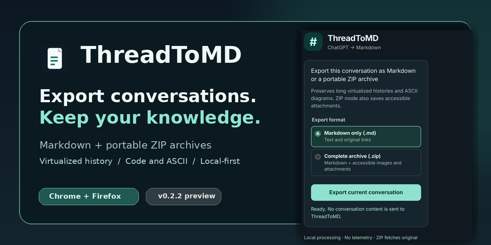
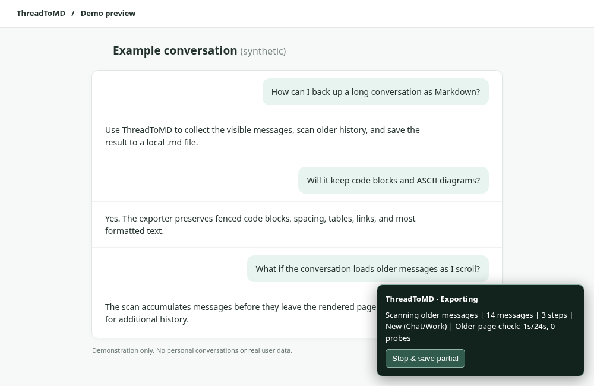

<p align="center">
  
</p>

<h1 align="center">ThreadToMD</h1>
<p align="center"><strong>Export ChatGPT conversations to Markdown, with an optional portable archive for accessible images and files.</strong></p>
<p align="center">
  
  
  
  <a href="LICENSE"></a>
</p>

<p align="center">
  
</p>

<p align="center">
  <a href="#quick-start">Quick start</a> | <a href="#features">Features</a> | <a href="#export-formats">Export formats</a> | <a href="#development">Development</a> | <a href="PRIVACY.md">Privacy</a>
</p>

> [!IMPORTANT]
> **v0.2.4 has completed manual release acceptance on Google Chrome 158.0.8127.36 and Mozilla Firefox 160.0.** Automated unit, package-integrity and synthetic browser tests also cover the core export paths. A completed scan still uses a **heuristic**, not an authoritative count from ChatGPT, so users should verify the first and last messages of important exports. This is an independent open-source project, not affiliated with or endorsed by OpenAI.

## Why ThreadToMD?

ChatGPT can keep only part of a long conversation in the page at a time. As you scroll, older or newer message elements may be created and removed. Copying the visible HTML can therefore miss parts of the discussion.

**ThreadToMD captures rendered messages incrementally while navigating the conversation**, then exports them in chronological order. It is designed for developers who want to keep technical discussions, code examples, architecture notes and diagrams in a format they can read, search and version-control.

## Features

| Capability | What you get |
| --- | --- |
| Long-chat capture | Scrolls through virtualized conversations and retains messages after their elements leave the DOM |
| Developer-friendly Markdown | Preserves headings, tables, links, code fences and whitespace-sensitive ASCII diagrams |
| Two export formats | A standalone `.md` or `.zip` with the Markdown and accessible local media/attachments |
| Offline references | Successful archived assets use relative links under `assets/` |
| Honest failure reporting | Missing files remain external or are marked unavailable; the ZIP includes `manifest.json` |
| Progress and recovery | On-page progress, stop-and-save-partial, and pause/resume when the tab loses visibility or focus |
| Local-first | No developer-operated server, telemetry, account-wide API or persistent conversation storage |
| Cross-browser | Shared source for Chrome/Chromium and Firefox; English UI with Brazilian Portuguese support |

## Quick start

**No build tools are required to use the packaged extension.** You can install a browser-specific ZIP attached to a GitHub Release, once a release is published. If no release asset is available yet, [build from source](#development).

### Chrome / Chromium

1. Download `threadtomd-chrome-0.2.4.zip` from **Releases** (or create it with `python3 scripts/build.py`).
2. **Extract** the ZIP to a folder.
3. Open `chrome://extensions/` and enable **Developer mode**.
4. Select **Load unpacked** and choose the extracted **folder containing `manifest.json`**.
5. Open a specific ChatGPT conversation, then click **ThreadToMD** in the toolbar (pin it from the extensions menu if needed).

### Firefox

1. Download `threadtomd-firefox-0.2.4.zip` from **Releases** (or create it with `python3 scripts/build.py`).
2. **Extract** the ZIP to a folder.
3. Open `about:debugging#/runtime/this-firefox`.
4. Select **Load Temporary Add-on...** and choose the extracted **`manifest.json` file**.
5. Open a specific ChatGPT conversation and click **ThreadToMD**.

Firefox temporary add-ons are removed when the browser is fully restarted. This is a developer-mode installation, not a signed store installation.

### Export in five steps

1. Open the **conversation itself** on `chatgpt.com` (not the home page).
2. Click the extension icon and choose **Markdown only (.md)** or **Complete archive (.zip)**.
   **On the first selection of ZIP**, the browser asks for optional access to supported attachment hosts, **before** you start the export. On Firefox 149+ the toolbar popup closes to expose the native permission prompt and, **after you allow access, reopens automatically**. On Chrome the popup normally stays open. ZIP remains selected either way. If popup restoration is blocked by the browser or you decline access, open it manually; no export starts until you press Export. **For a first-use test after upgrading, revoke the previously granted optional host access or use a fresh browser profile.**
3. Click **Export current conversation**. No permission dialog is triggered by this button. The popup closes and an on-page progress panel appears.
4. Leave the conversation tab open. Avoid manual scrolling; if you switch tabs or applications, the scan **pauses** and resumes when you return.
5. When the download finishes, compare the **first and last messages** with the original conversation. For ZIP archives, extract the full folder before opening `conversation.md`.

<p align="center">
  <a href="docs/screenshots/popup.png"></a>
  &nbsp;&nbsp;
  <a href="docs/screenshots/progress-demo.png"></a>
</p>
<p align="center"><sub>Demonstrations use synthetic data. Neither screenshot contains a private conversation.</sub></p>

## Export formats

| | Markdown only | Complete archive |
| --- | --- | --- |
| Output | `chatgpt-conversation-YYYYMMDD-HHMMSS.md` | `chatgpt-conversation-YYYYMMDD-HHMMSS.zip` |
| Conversation text | Yes | Yes, in `conversation.md` |
| Media and documents | Original references where available | Attempts to save accessible files and rewrite links locally |
| File failure report | No separate manifest | `manifest.json` with per-asset status and reasons |
| Optional host permission prompt | No | On first ZIP selection, not when pressing Export |

Files use the `conversa-chatgpt-...` prefix when the extension UI is in Portuguese (`pt` or `pt-BR`). Other locales default to English. **The original conversation content is never translated.**

A successful ZIP may look like this:

```text
chatgpt-conversation-YYYYMMDD-HHMMSS.zip
├── conversation.md
├── manifest.json
└── assets/
    ├── images/
    │   └── 001-diagram.png
    └── documents/
        └── 002-design-notes.pdf
```

Within `conversation.md`, images appear where they appeared in the chat:

```markdown
## 12. Assistant

Here is the architecture:


[Open the design notes](assets/documents/002-design-notes.pdf)
```

**Best effort, not a complete account backup:** the exporter can only archive media that the open page exposes and the browser can download. Expired or protected URLs, file cards without an accessible link, hidden branches and unsupported formats may be omitted. If the ZIP does not contain a referenced file, check `manifest.json`; no fake local link is created. External links, including `sandbox:` links, may stop working outside ChatGPT.

## Privacy and permissions

The extension runs on the **active ChatGPT conversation only after you click**. Markdown is assembled in your browser. The optional ZIP mode makes direct requests to original media/file hosts, not to a ThreadToMD server; those hosts can receive normal request metadata such as IP address and the requested URL.

| Browser permission | Why it is needed |
| --- | --- |
| `activeTab` | Temporary access to the selected conversation after the toolbar action |
| `scripting` | Run the bundled exporter in that tab |
| `storage` | Retain a short-lived popup-restoration intent in session memory while native permission UI is open |
| Optional, narrowly scoped host access | Only for ZIP mode, to retrieve supported OpenAI/CDN media with your consent |

The preferred export format is stored locally in the extension, and a short-lived consent-restoration marker (tab/window IDs and timestamp only) is held in `storage.session` memory. There is **no telemetry, analytics, developer-owned backend or persistent conversation/export storage**. The extension does not request the cookies, browsing-history or all-sites permissions. A ZIP can contain private conversation text, local files and sensitive original URLs: **review it before sharing or committing it to GitHub**.

Read the [privacy policy](PRIVACY.md) and [security policy](SECURITY.md).

## Known limitations

- **Message completeness is heuristic.** ChatGPT does not expose an authoritative total through the rendered page; check the export boundaries yourself. A stalled scan is marked partial instead of silently claiming success.
- **Background work is paused deliberately.** Return to the conversation to finish. Closing, reloading or browser-discarding the tab loses the in-memory run.
- **Attachments are best effort.** ZIP mode has caps of **200 assets**, **24 MiB per asset**, **160 MiB total**, **3 concurrent downloads** and an approximately **32-second per-file timeout**. Large archives still require browser memory; ZIP64 is not supported.
- Audio/video, interactive apps, canvas-based media, unrendered chat branches and unsupported asset types are not archived.
- In Firefox versions older than 149 or when browser focus changes, automatic popup restoration may be unavailable; the user can reopen the extension manually.
- Changes in ChatGPT's HTML structure can require updates to the DOM adapters.

See [Troubleshooting](docs/TROUBLESHOOTING.md) for practical fixes and [Release checklist](docs/RELEASE_CHECKLIST.md) for what has and has not been validated.

## Development

The production extension is plain JavaScript (Manifest V3), with **no runtime framework or bundler**. The package builder uses Python's standard library. Unit tests run on Node.js 22+; synthetic browser tests use Python Playwright + Chromium.

```bash
# From the repository root
python3 scripts/build.py
npm test
```

The build produces `dist/chrome/`, `dist/firefox/` and the two installable archives. Generated `dist/` content is intentionally excluded from source control.

To run the full browser test matrix and learn the project layout, use the [Developer guide](docs/DEVELOPMENT.md). Core modules:

```text
popup/                Export mode, on-demand permissions and injection
src/exporter.js       Virtualized DOM scan, message ordering and Markdown
src/archive.js        Asset discovery, ZIP writer and local references
src/i18n.js           English / Portuguese runtime strings
background/assets.js Bounded asset download relay for approved hosts
background/permission_popup.js One-shot, session-only popup restoration after consent
background/worker.js Chrome MV3 entrypoint; Firefox loads individual scripts
scripts/build.py      Cross-browser package builder
tests/                Synthetic fixtures, unit tests and browser regressions
```

## Project documentation

- [Developer guide](docs/DEVELOPMENT.md) - setup, tests, file layout and debugging
- [Architecture](docs/ARCHITECTURE.md) - scanner, media relay, resource limits and data flow
- [Troubleshooting](docs/TROUBLESHOOTING.md) - installation, missing messages and inaccessible files
- [Contributing](CONTRIBUTING.md) - contribution rules and test expectations
- [Changelog](CHANGELOG.md) - version history
- [Publishing](docs/PUBLISHING.md) - GitHub release and browser-store preparation
- [Release evidence](docs/TEST_RESULTS_v0.2.4.md) - automated regression results and manual Chrome/Firefox acceptance

## Contributing and license

Bug reports, reproducible synthetic fixtures and focused pull requests are welcome. **Please never upload an unredacted chat export to a public issue.** See [Contributing](CONTRIBUTING.md) and [Security](SECURITY.md).

ThreadToMD is open source under the [MIT License](LICENSE). ChatGPT is a trademark of its respective owner; this project is independent and not endorsed by OpenAI.
