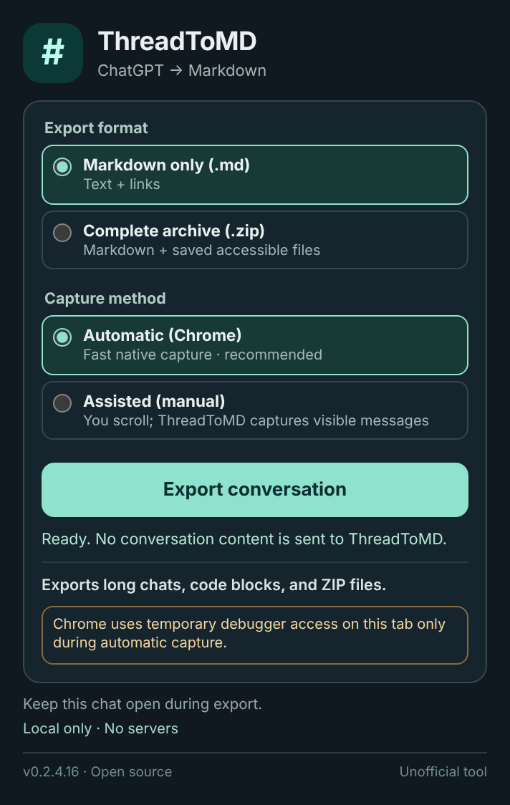
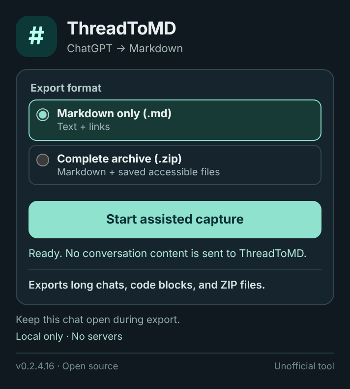

<p align="center">
  
</p>

<h1 align="center">ThreadToMD</h1>
<p align="center"><strong>Export ChatGPT conversations to Markdown, with an optional portable archive for accessible images and files.</strong></p>
<p align="center">
  <a href="https://github.com/mw-ferretti/thread-to-md/releases/tag/v0.2.4.16"></a>
  
  
  <a href="LICENSE"></a>
</p>

<p align="center">
  
</p>

<p align="center">
  <a href="https://github.com/mw-ferretti/thread-to-md/releases/tag/v0.2.4.16"><strong>Download v0.2.4.16</strong></a> | <a href="#quick-start">Quick start</a> | <a href="#features">Features</a> | <a href="#export-formats">Export formats</a> | <a href="#development">Development</a> | <a href="PRIVACY.md">Privacy</a>
</p>

<p align="center">
  <a href="https://github.com/mw-ferretti/thread-to-md/releases/download/v0.2.4.16/threadtomd-chrome-0.2.4.16.zip"><strong>Chrome / Chromium ZIP</strong></a>
  &nbsp;&nbsp;·&nbsp;&nbsp;
  <a href="https://github.com/mw-ferretti/thread-to-md/releases/download/v0.2.4.16/threadtomd-firefox-0.2.4.16.zip"><strong>Firefox ZIP</strong></a>
  &nbsp;&nbsp;·&nbsp;&nbsp;
  <a href="https://github.com/mw-ferretti/thread-to-md/releases/tag/v0.2.4.16">Release notes</a>
</p>

> [!IMPORTANT]
> **Release v0.2.4.16:** The Chrome native-automatic engine was successfully exercised in a real long ChatGPT conversation in v0.2.4.15: a confirmed scrolling-widget loop was bypassed and the user reported a full export. v0.2.4.16 changes only the popup layout/text and version metadata; its popup, packages and unit tests passed synthetic checks. **The exact v0.2.4.16 build and its Firefox manual-only path still need a fresh live-browser smoke test.** ChatGPT exposes no authoritative message total; verify the first and last messages. This is an independent project, not endorsed by OpenAI.

## Why ThreadToMD?

ChatGPT can keep only part of a long conversation in the page at a time. As you scroll, older or newer message elements may be created and removed. Copying the visible HTML can therefore miss parts of the discussion.

**ThreadToMD captures rendered messages incrementally while navigating the conversation**, then exports them in chronological order. It is designed for developers who want to keep technical discussions, code examples, architecture notes and diagrams in a format they can read, search and version-control.

## Features

| Capability | What you get |
| --- | --- |
| Long-chat capture | Chrome uses browser-trusted native wheel input; Firefox captures as you scroll manually, preserving messages after DOM virtualization removes them |
| Developer-friendly Markdown | Preserves headings, tables, links, code fences and whitespace-sensitive ASCII diagrams |
| Two export formats | A standalone `.md` or `.zip` with the Markdown and accessible local media/attachments |
| Offline references | Successful archived assets use relative links under `assets/` |
| Honest failure reporting | Missing files remain external or are marked unavailable; the ZIP includes `manifest.json` |
| Progress and recovery | On-page progress and partial-export fallback; Chrome can bypass up to three previously captured nested code widgets when a confirmed loop blocks the upward scan |
| Local-first | No developer-operated server, telemetry, account-wide API or persistent conversation storage |
| Cross-browser | One source tree, browser-specific capture modes and permissions; English UI with Brazilian Portuguese support |

## Quick start

**No build tools are required to use the packaged extension.** Download the browser-specific ZIP from the [v0.2.4.16 release](https://github.com/mw-ferretti/thread-to-md/releases/tag/v0.2.4.16), or [build from source](#development).

### Chrome / Chromium

1. Download [`threadtomd-chrome-0.2.4.16.zip`](https://github.com/mw-ferretti/thread-to-md/releases/download/v0.2.4.16/threadtomd-chrome-0.2.4.16.zip) from the v0.2.4.16 release (or create it with `python3 scripts/build.py`).
2. **Extract** the ZIP to a folder.
3. Open `chrome://extensions/` and enable **Developer mode**.
4. Select **Load unpacked** and choose the extracted **folder containing `manifest.json`**.
5. Open a specific ChatGPT conversation, then click **ThreadToMD** in the toolbar (pin it from the extensions menu if needed).

### Firefox

1. Download [`threadtomd-firefox-0.2.4.16.zip`](https://github.com/mw-ferretti/thread-to-md/releases/download/v0.2.4.16/threadtomd-firefox-0.2.4.16.zip) from the v0.2.4.16 release (or create it with `python3 scripts/build.py`).
2. **Extract** the ZIP to a folder.
3. Open `about:debugging#/runtime/this-firefox`.
4. Select **Load Temporary Add-on...** and choose the extracted **`manifest.json` file**.
5. Open a specific ChatGPT conversation and click **ThreadToMD**.

Firefox temporary add-ons are removed when the browser is fully restarted. This is a developer-mode installation, not a signed store installation.

### Export in five steps

1. Open a specific conversation on `chatgpt.com`, then click the ThreadToMD toolbar icon.
2. Choose **Markdown only (.md)** or **Complete archive (.zip)**. The first ZIP selection asks for optional access to supported original asset hosts. On Firefox the popup may close to show the browser prompt, then attempt to reopen with ZIP still selected; reopen it yourself if the browser does not allow this. Permission approval never starts export by itself.
3. **Chrome:** choose **Automatic (Chrome)** (the default) or **Assisted (manual)**. The automatic mode uses Chrome's sensitive `debugger` permission only while working with the selected ChatGPT tab. **Firefox:** manual capture is the only mode; there is no Chrome debugger permission.
4. Click **Export conversation** (Chrome automatic) or **Start assisted capture** (manual). For Chrome automatic, keep the tab open, let ThreadToMD navigate it, and avoid opening that tab's DevTools. For manual mode, **scroll to the first message and then back to the last**, and click **Finish** in the on-page panel. If you switch away during automatic export, return to the tab to let it resume.
5. Open the saved file, confirm the **first and last messages**, and check any partial-status warnings. Extract the ZIP before opening `conversation.md`; check `manifest.json` for unavailable assets.

<p align="center">
  <a href="docs/screenshots/popup.png"></a>
  &nbsp;&nbsp;
  <a href="docs/screenshots/popup-firefox.png"></a>
</p>
<p align="center"><sub>Actual extension popup HTML/CSS, rendered in Chromium with synthetic tab data. <a href="docs/screenshots/popup-pt-BR.png">Portuguese Chrome popup</a> · <a href="docs/screenshots/popup-firefox-pt-BR.png">Portuguese Firefox popup</a></sub></p>
<p align="center">
  <a href="docs/screenshots/progress-demo.png"></a>
</p>
<p align="center"><sub>Synthetic demonstration, not a screenshot of private chats or proof of complete live-site exports.</sub></p>

## Export formats

| | Markdown only | Complete archive |
| --- | --- | --- |
| Output | `chatgpt-conversation-YYYYMMDD-HHMMSS.md` | `chatgpt-conversation-YYYYMMDD-HHMMSS.zip` |
| Conversation text | Yes | Yes, in `conversation.md` |
| Media and documents | Original references where available | Attempts to save accessible files and rewrite links locally |
| File failure report | No separate manifest | `manifest.json` with per-asset status and reasons |
| Optional host permission prompt | No | On first ZIP selection, not when pressing Export |

Files use the `conversa-chatgpt-...` prefix when the extension UI is in Portuguese (`pt` or `pt-BR`). Other locales default to English. **The original conversation content is never translated.**

A successful ZIP may look like this:

```text
chatgpt-conversation-YYYYMMDD-HHMMSS.zip
├── conversation.md
├── manifest.json
└── assets/
    ├── images/
    │   └── 001-diagram.png
    └── documents/
        └── 002-design-notes.pdf
```

Within `conversation.md`, images appear where they appeared in the chat:

```markdown
## 12. Assistant

Here is the architecture:


[Open the design notes](assets/documents/002-design-notes.pdf)
```

**Best effort, not a complete account backup:** the exporter can only archive media that the open page exposes and the browser can download. Expired or protected URLs, file cards without an accessible link, hidden branches and unsupported formats may be omitted. If the ZIP does not contain a referenced file, check `manifest.json`; no fake local link is created. External links, including `sandbox:` links, may stop working outside ChatGPT.

## Privacy and permissions

The extension runs on the **active ChatGPT conversation only after you click**. Markdown is assembled in your browser. The optional ZIP mode makes direct requests to original media/file hosts, not to a ThreadToMD server; those hosts can receive normal request metadata such as IP address and the requested URL.

| Browser permission | Why it is needed |
| --- | --- |
| `activeTab` | Temporary access to the selected conversation after the toolbar action |
| `scripting` | Run the bundled exporter in that tab |
| `storage` | Retain a short-lived popup-restoration intent in session memory while native permission UI is open |
| Chrome-only `debugger` | Send browser-trusted wheel events to the selected ChatGPT tab during automatic capture; detached on termination/navigation and **not included in Firefox** |
| Optional, narrowly scoped host access | Only for ZIP mode, to retrieve supported OpenAI/CDN media with your consent |

The preferred export format is stored locally in the extension, and a short-lived consent-restoration marker (tab/window IDs and timestamp only) is held in `storage.session` memory. There is **no telemetry, analytics, developer-owned backend or persistent conversation/export storage**. The extension does not request the cookies, browsing-history or all-sites permissions. A ZIP can contain private conversation text, local files and sensitive original URLs: **review it before sharing or committing it to GitHub**.

Read the [privacy policy](PRIVACY.md) and [security policy](SECURITY.md).

## Known limitations

- **Message completeness is heuristic.** ChatGPT does not expose an authoritative total through the rendered page; check the export boundaries yourself. A stalled scan can switch to an explicitly partial manual fallback.
- **Chrome automatic uses the sensitive `debugger` permission.** It is scoped by the extension to the selected ChatGPT tab and should not be used concurrently with that tab's DevTools. Review the permissions before installing. Firefox does not request this permission.
- **Chrome loop recovery temporarily changes the page DOM.** Only a previously captured, verified scrollable code widget is detached (up to three per run), then restored where possible. This can interfere with ChatGPT's React rendering; reload the chat if its display becomes inconsistent. Firefox only offers manual capture.
- **Chrome automatic pauses when the conversation tab is inactive.** Return to resume. Closing, reloading or browser-discarding the tab loses the in-memory run. Firefox manual capture requires you to navigate the chat yourself.
- **Attachments are best effort.** ZIP mode has caps of **200 assets**, **24 MiB per asset**, **160 MiB total**, **3 concurrent downloads** and an approximately **32-second per-file timeout**. Large archives still require browser memory; ZIP64 is not supported.
- Audio/video, interactive apps, canvas-based media, unrendered chat branches and unsupported asset types are not archived.
- In Firefox versions older than 149 or when browser focus changes, automatic popup restoration may be unavailable; the user can reopen the extension manually.
- Changes in ChatGPT's HTML structure can require updates to the DOM adapters.

See [Troubleshooting](docs/TROUBLESHOOTING.md) for practical fixes and [Release checklist](docs/RELEASE_CHECKLIST.md) for what has and has not been validated.

## Development

The production extension is plain JavaScript (Manifest V3), with **no runtime framework or bundler**. The package builder uses Python's standard library. Unit tests run on Node.js 22+; synthetic browser tests use Python Playwright + Chromium.

```bash
# From the repository root
python3 scripts/build.py
npm test
```

The build produces `dist/chrome/`, `dist/firefox/` and the two installable archives. Generated `dist/` content is intentionally excluded from source control.

To run the full browser test matrix and learn the project layout, use the [Developer guide](docs/DEVELOPMENT.md). Core modules:

```text
popup/                Export mode, on-demand permissions and injection
src/exporter.js       Virtualized DOM scan, message ordering and Markdown
src/archive.js        Asset discovery, ZIP writer and local references
src/i18n.js           English / Portuguese runtime strings
background/assets.js Bounded asset download relay for approved hosts
background/permission_popup.js One-shot, session-only popup restoration after consent
background/native_wheel.js Chrome-only browser-debugger wheel transport
background/worker.js Chrome MV3 entrypoint; Firefox loads individual scripts
scripts/build.py      Cross-browser package builder
tests/                Synthetic fixtures, unit tests and browser regressions
```

## Project documentation

- [Documentation index](docs/README.md) - current release materials, visuals, and historical experiment records
- [Developer guide](docs/DEVELOPMENT.md) - setup, tests, file layout and debugging
- [Architecture](docs/ARCHITECTURE.md) - scanner, media relay, resource limits and data flow
- [Troubleshooting](docs/TROUBLESHOOTING.md) - installation, missing messages and inaccessible files
- [Contributing](CONTRIBUTING.md) - contribution rules and test expectations
- [Changelog](CHANGELOG.md) - version history
- [Publishing](docs/PUBLISHING.md) - GitHub release and browser-store preparation
- [v0.2.4.16 release notes](docs/RELEASE_NOTES_v0.2.4.16.md) - current features, browser differences and upgrade guidance
- [Release evidence](docs/TEST_RESULTS_v0.2.4.16.md) - new popup/package test results and live-test limitations; [v0.2.4 evidence](docs/TEST_RESULTS_v0.2.4.md) remains historical

## Contributing and license

Bug reports, reproducible synthetic fixtures and focused pull requests are welcome. **Please never upload an unredacted chat export to a public issue.** See [Contributing](CONTRIBUTING.md) and [Security](SECURITY.md).

ThreadToMD is open source under the [MIT License](LICENSE). ChatGPT is a trademark of its respective owner; this project is independent and not endorsed by OpenAI.
