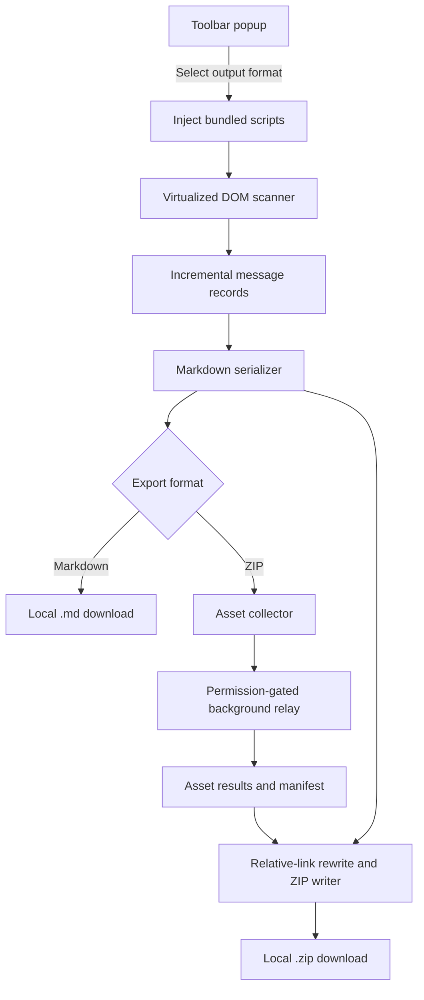

# Architecture

ThreadToMD v0.2.4 is a deliberately small Manifest V3 WebExtension with **one shared codebase** for Chrome and Firefox. It operates on the currently selected conversation, not an account-wide API.

## Data flow

The diagram is conceptual: image and attachment references are registered **while the corresponding message is visible**, and supported binary downloads are awaited as required before advancing away from transient content.

## Responsibilities

| Module | Responsibility |
| --- | --- |
| `popup/popup.js` | Checks active tab, requests optional host access synchronously when ZIP is selected, injects on a separate Export click; requests one-shot popup restoration; Firefox dismisses its panel before native consent and restores the UI on grant where supported |
| `src/exporter.js` | Detects classic/Chat/Work DOM shapes, scrolls both directions, accumulates ordered messages, renders Markdown, manages pause/resume |
| `src/archive.js` | Discovers assets in rendered messages, de-duplicates, requests binaries, creates local references, writes `manifest.json` and ZIP |
| `background/assets.js` | Fetches supported HTTPS URLs from an allowlist in Chrome MV3 service worker or Firefox background context |
| `background/permission_popup.js` | Receives user-initiated ZIP consent intent, watches permission grants, and restores a closed popup without duplicate opening |
| `background/worker.js` | Chrome MV3 service-worker entrypoint loading independent background modules |
| `src/i18n.js` and `_locales/` | English-default UI, `pt`/`pt-BR` support, manifest translations; conversation text unchanged |
| `scripts/build.py` | Creates both browser packages without a JavaScript bundler |

## Native permission handoff

When the user selects ZIP, `popup/popup.js` registers a short-lived restoration intent in the background **without awaiting it**, then immediately invokes `permissions.request()` within the original click handler. Chrome usually keeps the popup open; Firefox closes it to keep its permission dialog visible. The `permissions.onAdded` listener verifies all expected origins were granted, waits briefly for the browser dialog to settle, and opens the action popup only if the original popup is no longer alive and its tab/window is still active. A port tracks live popup views to prevent duplicate openings.

The handoff record contains only a tab ID, window ID, and timestamp in `storage.session` (cleared on browser restart and consumed on grant); it expires after 3 minutes. Firefox 149+ supports programmatic `action.openPopup()` without a new user gesture. Reopening can still fail if the user switches windows, the tab closes, or browser UI blocks it; manual reopening remains possible. **Permission consent never starts an export automatically**.

## Virtualized history capture

A long conversation may present only a sliding window of its messages in the DOM. The exporter traverses upward to older messages and downward to newer messages, collecting before elements disappear. The known DOM layouts have synthetic fixtures in `tests/fixtures/`; new layouts require new fixtures and regression tests.

The first/last boundary uses observed scroll position, content changes and quiet periods. This is a **heuristic**, not a remote message count. A stall or timeout may yield a partial export. When the tab is hidden or the browser window loses focus, the scan pauses and excludes inactive time from boundary detection; it resumes after focus returns. Browser reload/discard ends the in-memory run.

## Archive behavior

ZIP mode registers visible images (including some `blob:` and `data:` sources) and direct document links. Successful downloads receive paths such as `assets/images/001-diagram.png` or `assets/documents/002-notes.pdf`. Unavailable files retain an original link when possible or an explicit placeholder.

When the user selects ZIP and consents to the optional host permission prompt, the background relay can fetch from a narrow list of OpenAI/CDN URLs despite content-script page CORS restrictions. This does **not** bypass expired URLs, authentication or missing download links. First-party requests may carry a browser session; third-party requests omit credentials.

Per transfer, the relay sends base64-encoded data in **48 KiB acknowledged chunks**; the content side does not request the next chunk until the previous one has been accepted. The archive is assembled locally with ZIP STORE entries and CRC32 integrity metadata.

Limits in v0.2.4: **200 distinct assets**, **24 MiB/file**, **160 MiB total asset bytes**, **3 concurrent asset requests**, **~32-second download timeout/file**. No ZIP64. These controls cap asset payloads, but the browser still holds the captured messages and ZIP output in memory before download. Streaming-to-disk archives are not yet implemented.

`manifest.json` records the export scan status and assets with `saved`, `failed`, `unsupported` or `unavailable` outcomes. Successful local paths are never fabricated for failed downloads. The manifest avoids copying inline data URL payloads or blob URLs, but users should still treat it as private output.

## Security and privacy boundaries

- No server operated by ThreadToMD, telemetry, account API, stored credentials, or persistent conversation database.
- No all-sites host permission. `activeTab`/`scripting` are granted through a user-triggered toolbar action; known media hosts are optional for ZIP mode. Required `storage` permission holds only a short-lived popup-restoration marker in session memory.
- Background downloads verify sender origin, HTTPS destination and supported file types; disallowed redirects and HTML/SVG masquerading as binary files fail.
- Resource limits, sanitized ZIP paths, de-duplication and conservative failure reporting reduce risk; they do not guarantee archival completeness.

See [Privacy](../PRIVACY.md), [Security](../SECURITY.md), [Developer guide](DEVELOPMENT.md) and [Test results](TEST_RESULTS_v0.2.4.md).
