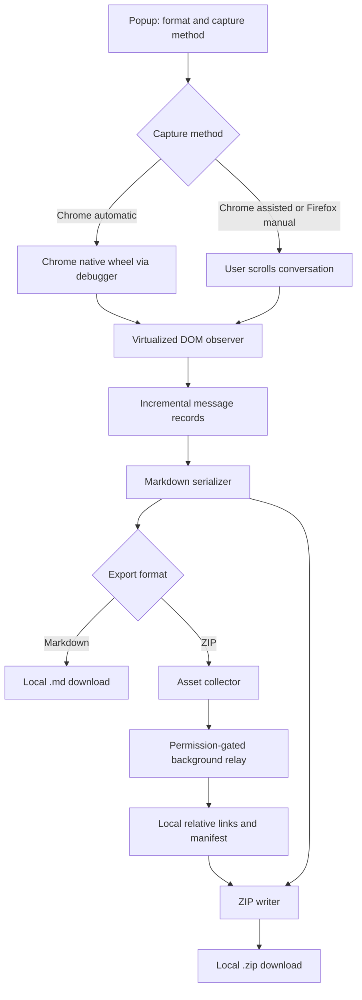

# Architecture

ThreadToMD v0.2.4.16 is a Manifest V3 WebExtension with **one shared source tree** and browser-specific capture modes. Chrome supports native automatic capture or assisted manual capture; Firefox supports manual capture only. Both operate on the currently selected conversation, not an account-wide API.

## Data flow

The diagram is conceptual: image and attachment references are registered **while the corresponding message is visible**, and supported binary downloads are awaited as required before advancing away from transient content.

## Responsibilities

| Module | Responsibility |
| --- | --- |
| `popup/popup.js` | Checks active tab, requests optional host access synchronously when ZIP is selected, injects on a separate Export click; requests one-shot popup restoration; Firefox dismisses its panel before native consent and restores the UI on grant where supported |
| `src/exporter.js` | Detects classic/Chat/Work DOM, accumulates ordered messages, renders Markdown, manages automatic/native and assisted modes, and guards confirmed scrolling-widget loops |
| `src/archive.js` | Discovers assets in rendered messages, de-duplicates, requests binaries, creates local references, writes `manifest.json` and ZIP |
| `background/assets.js` | Fetches supported HTTPS URLs from an allowlist in Chrome MV3 service worker or Firefox background context |
| `background/permission_popup.js` | Receives user-initiated ZIP consent intent, watches permission grants, and restores a closed popup without duplicate opening |
| `background/worker.js` | Chrome MV3 service-worker entrypoint loading independent background modules |
| `background/native_wheel.js` | **Chrome only:** attaches the debugger to the initiating ChatGPT tab, sends native wheel events, and detaches when done or interrupted |
| `src/i18n.js` and `_locales/` | English-default UI, `pt`/`pt-BR` support, manifest translations; conversation text unchanged |
| `scripts/build.py` | Creates both browser packages without a JavaScript bundler |

## Native permission handoff

When the user selects ZIP, `popup/popup.js` registers a short-lived restoration intent in the background **without awaiting it**, then immediately invokes `permissions.request()` within the original click handler. Chrome usually keeps the popup open; Firefox closes it to keep its permission dialog visible. The `permissions.onAdded` listener verifies all expected origins were granted, waits briefly for the browser dialog to settle, and opens the action popup only if the original popup is no longer alive and its tab/window is still active. A port tracks live popup views to prevent duplicate openings.

The handoff record contains only a tab ID, window ID, and timestamp in `storage.session` (cleared on browser restart and consumed on grant); it expires after 3 minutes. Firefox 149+ supports programmatic `action.openPopup()` without a new user gesture. Reopening can still fail if the user switches windows, the tab closes, or browser UI blocks it; manual reopening remains possible. **Permission consent never starts an export automatically**.

## Virtualized history capture

A long conversation may present only a sliding window of its messages in the DOM. The exporter captures each visible window before the site removes those DOM nodes.

**Chrome automatic (default):** Chrome's sensitive `debugger` permission is used to dispatch browser-trusted wheel input to the selected chat tab (normal steps: 160px at 110ms intervals). The v0.2.4.10 native motor observes viewport cycles and bounds recovery. The v0.2.4.15 improvement, retained in v0.2.4.16, may detach a **captured** code widget that has verified internal vertical scrolling if a confirmed loop blocks upward traversal. It checks stable owner identity and matching canonical Markdown before touching the DOM, drains accessible ZIP assets first, removes no more than three widgets in a run, and restores at the original position **when it is still mounted**. This operation can conflict with React reconciliation and cannot guarantee page stability; reloading the chat can recover its original rendering. Unsafe cases fall back to manual capture, marked partial/unverified.

**Chrome assisted and Firefox manual:** the user scrolls upward to the oldest rendered message and downward to the newest; ThreadToMD records visible messages incrementally. The user clicks **Finish** to save an explicitly unverified/manual export. Firefox does not bundle the native wheel worker or request `debugger`.

The first/last boundary uses scroll observations, content changes and quiet periods. This is a **heuristic**, not an authoritative ChatGPT message count. Automatic capture pauses while the tab is inactive and resumes when it becomes active again. Closing/reloading or browser-discarding the tab ends the in-memory run. Synthetic fixtures validate known DOM shapes but not all possible live ChatGPT behavior.

## Archive behavior

ZIP mode registers visible images (including some `blob:` and `data:` sources) and direct document links. Successful downloads receive paths such as `assets/images/001-diagram.png` or `assets/documents/002-notes.pdf`. Unavailable files retain an original link when possible or an explicit placeholder.

When the user selects ZIP and consents to the optional host permission prompt, the background relay can fetch from a narrow list of OpenAI/CDN URLs despite content-script page CORS restrictions. This does **not** bypass expired URLs, authentication or missing download links. First-party requests may carry a browser session; third-party requests omit credentials.

Per transfer, the relay sends base64-encoded data in **48 KiB acknowledged chunks**; the content side does not request the next chunk until the previous one has been accepted. The archive is assembled locally with ZIP STORE entries and CRC32 integrity metadata.

Limits retained in v0.2.4.16: **200 distinct assets**, **24 MiB/file**, **160 MiB total asset bytes**, **3 concurrent asset requests**, **~32-second download timeout/file**. No ZIP64. These controls cap asset payloads, but the browser still holds the captured messages and ZIP output in memory before download. Streaming-to-disk archives are not yet implemented.

`manifest.json` records the export scan status and assets with `saved`, `failed`, `unsupported` or `unavailable` outcomes. Successful local paths are never fabricated for failed downloads. The manifest avoids copying inline data URL payloads or blob URLs, but users should still treat it as private output.

## Security and privacy boundaries

- No server operated by ThreadToMD, telemetry, account API, stored credentials, or persistent conversation database.
- No all-sites host permission. `activeTab`/`scripting` are used after a user-triggered toolbar action; known media hosts are optional for ZIP mode. Required `storage` holds only a short-lived popup-restoration marker. Chrome alone additionally requests the sensitive `debugger` permission for tab-scoped native scrolling; Firefox excludes it.
- Background downloads verify sender origin, HTTPS destination and supported file types; disallowed redirects and HTML/SVG masquerading as binary files fail.
- Resource limits, sanitized ZIP paths, de-duplication and conservative failure reporting reduce risk; they do not guarantee archival completeness.

See [Privacy](../PRIVACY.md), [Security](../SECURITY.md), [Developer guide](DEVELOPMENT.md) and [v0.2.4.16 evidence](TEST_RESULTS_v0.2.4.16.md). Historical evidence for v0.2.4 remains at [TEST_RESULTS_v0.2.4.md](TEST_RESULTS_v0.2.4.md).
